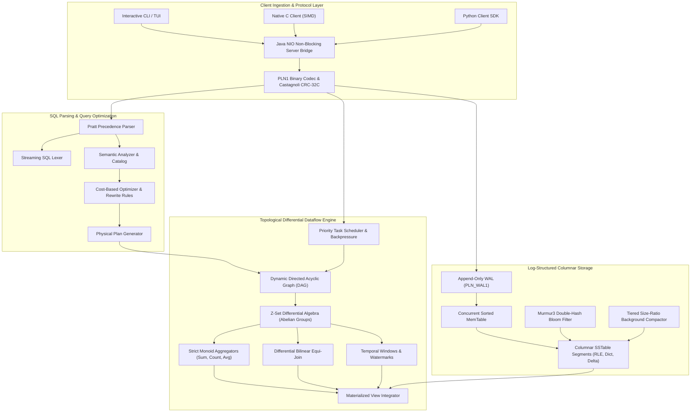

# Plinth Architecture

Plinth is a purely functional stream-relational database and continuous query engine implemented in Frege on the Java Virtual Machine. It combines the formal mathematical calculus of Database Stream Processing (DBSP), vectorized columnar execution, and log-structured merge storage into a unified streaming database platform.

---

## 1. Purely Functional JVM Engine (Frege)

Frege is a purely functional language for the JVM closely aligned with Haskell 2010. By constructing Plinth in Frege, all query plans, differential operators, data structures, and state transitions are pure referentially-transparent expressions.

### Referential Transparency and State Mutation
- **Abelian Group Semantics**: Mutations in dataflow streams are modeled mathematically as differences between relations ($Z$-Sets) with signed integer weights. Adding positive weights represents record insertion; adding negative weights represents retraction.
- **Garbage Collection Efficiency**: Immutable structures share subtrees via structural sharing (`TreeMap`, immutable bitsets), eliminating mutable memory corruption risks.
- **Strict Tail-Recursive Execution**: Hot reduction paths force immediate accumulator evaluation, preventing lazy evaluation thunk accumulation and avoiding stack overflows on multi-million event streams.

---

## 2. DBSP Differential Stream Calculus

Traditional streaming databases recompute query states or rely on ad-hoc incremental delta rules for each operator. Plinth implements the unified Database Stream Processing (DBSP) differential calculus developed by Budiu et al.

### Linear vs. Bilinear Operators
1. **Linear Operators**: Operators such as projection ($\pi$), selection ($\sigma$), and union ($\cup$) commute directly with differentiation:
   $$\mathcal{D}(L(R)) = L(\mathcal{D}(R))$$
   Linear operators require zero state retention; the output delta is computed solely from the input delta without consulting historical snapshots.
2. **Bilinear Operators (Equi-Joins)**: For two time-varying relations $R$ and $S$, differentiation produces the bilinear delta propagation rule:
   $$\Delta(R \bowtie S) = (\Delta R \bowtie S_{prev}) + (R_{prev} \bowtie \Delta S) + (\Delta R \bowtie \Delta S)$$
   Plinth maintains internal join states index-partitioned on the join key to evaluate incremental join deltas in sub-millisecond latencies.
3. **State Integration**: Materialized views act as state integrators ($\mathcal{I}$):
   $$\mathcal{I}(s)[t] = \sum_{i=0}^t s[i]$$
   Continuous queries emit only changes (`EMIT CHANGES`), enabling downstream clients to subscribe to real-time differential feeds with minimal bandwidth overhead.

---

## 3. Streaming SQL Compiler & Query Optimizer

Plinth provides a streaming SQL compiler supporting standard relational algebra augmented with continuous query semantics.

- **Lexer (`Lexer.fr`)**: Pure streaming tokenizer parsing SQL keywords (`SELECT`, `FROM`, `WHERE`, `GROUP BY`, `EMIT CHANGES`), identifiers, numbers, timestamps, and string escapes.
- **Pratt Precedence Parser (`Parser.fr`)**: Top-down operator precedence (Pratt) expression parser handling arbitrary arithmetic, boolean logic, and parenthesized expressions with correct precedence climbing.
- **Semantic Type Checker (`TypeChecker.fr`)**: Type derivations across stream schemas, validating column existence, nullability constraints, and function signatures against the engine catalog.
- **Logical Optimizer (`Rules.fr`)**: Rule-based algebraic optimizer applying predicate pushdown below joins, projection pruning, and constant folding.
- **Cost-Based Optimizer (`CostModel.fr`)**: Cardinality estimator calculating hyperloglog-inspired distinct count estimates to optimize multi-way join ordering.

---

## 4. Columnar Vectorized Execution

Data processing in Plinth operates on typed columnar vectors rather than row-oriented tuple objects:
- **`ColumnVector`**: Flat homogeneous primitive arrays for `Bool`, `Int32`, `Int64`, `Float64`, `String`, and `Timestamp`.
- **Validity Bitmap**: Immutable functional bitsets tracking nullability per row without object overhead.
- **Vectorized Record Batches (`VectorBatch`)**: Cache-aligned columnar blocks supporting zero-copy slicing, column projection, and SIMD gather operations.
- **Compression Codecs (`Compression.fr`)**: Native columnar encodings:
  - Run-Length Encoding (RLE) for repeated categorical entries.
  - Dictionary Encoding for low-cardinality string keys.
  - Delta-of-Delta Encoding for monotonically increasing timestamps and identifiers.

---

## 5. Storage Subsystem (LSM-Tree)

For persistent durability and historical stream lookups, Plinth incorporates an append-only log-structured merge storage subsystem:
- **Write-Ahead Log (`WALRecord.fr`)**: Append-only log framing every incoming delta transaction with binary magic bytes (`0x504C4E31`) and Castagnoli CRC-32C checksums.
- **MemTable (`MemTable.fr`)**: In-memory sorted write buffer ordered by primary key.
- **Bloom Filter (`BloomFilter.fr`)**: Space-efficient filter utilizing Kirsch-Mitzenmacher double hashing over 64-bit seed hashes to prune unnecessary SSTable segment disk reads.
- **SSTable Segments (`Segment.fr`)**: Immutable on-disk columnar segments with two-level sparse index blocks for binary search seeking.
- **Tiered Compaction (`Compaction.fr`)**: Size-tiered background compaction merging sorted segments and purging canceled retractions ($w = 0$).

---

## 6. PLN1 Wire Protocol & Multi-Language SDKs

- **PLN1 Protocol**: Fast binary wire protocol with 16-byte fixed headers, correlation IDs, opcode multiplexing, and CRC-32C verification.
- **Java NIO Bridge**: High-concurrency non-blocking socket server routing binary requests into the Frege streaming runtime.
- **Native C SDK (`c_src/`)**: High-performance C99 client with hardware-accelerated CRC-32C (ARM64 NEON / SSE4.2) and vectorized filter/gather kernels.
- **Python Client SDK (`python/`)**: Python SDK with CLI repl and real-time ANSI terminal monitoring dashboard (`plinth-tui`).
